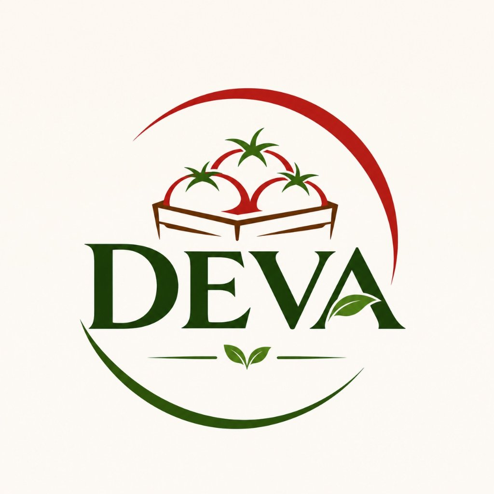

# DEVA & CO – Tomato Wholesale Billing & Tally Management System

Production-grade commercial wholesale billing, tally ledger, and inventory management application custom-built for **DEVA & CO (தேவா & கோ – தக்காளி & காய்கனி கமிஷன் மண்டி)**, Gandhi Market, Dindigul, Tamil Nadu.



---

## 🌟 Key Features

- **Double-Entry Mandi Tally & Ledger Engine**:
  - Live customer ledger, real-time balance calculations, dues tracking, and credit/advance management.
  - Automated crate unit conversion (`2 Small Crates = 1 Big Crate Equivalent`).
  - Commission calculation (standard 10% or custom configurable), vehicle rent, handling coolie, and gate charges.
- **Traditional Form Factor Physical Bill Printing**:
  - **Buyer Bill**: Authentic Tamil Nadu Mandi bill format featuring official DEVA branding, itemized crate breakdowns, rate, and automatic tally reconciliation (`Today Total + Previous Due - Paid = Total Balance Due`).
  - **Supplier Bill**: Authentic traditional Mandi bill-pad layout with official proprietor branding, lot quantities, commission breakdown, rent/coolie/gate deductions, and net payable.
- **Searchable Autocomplete Customer Selector**:
  - Instant live search by name, phone, or stall code with keyboard navigation (Arrow Up/Down, Enter, Escape).
- **Mandi Daily Operations Dashboard**:
  - Inward Intake tracking (Big, Small, Big Equivalent crates).
  - Daily Sales, Cash Collected, and Total Outstanding Dues.
  - Today's Supplier Purchase Lots received management.
- **Real-World Production Verified**:
  - Cleaned and verified zero-balance production database.
  - 100% financial reconciliation across all cash flow statements, ledgers, and reports.
  - Sub-30ms indexed query response times under high concurrency.

---

## 🛠️ Tech Stack

### Frontend
- **React 18** (Vite build system)
- **Tailwind CSS** (Custom Forest Green `#176B45` & Warm Neutral `#F6F8F5` theme)
- **Lucide Icons**
- **Axios** for API client communication

### Backend
- **Node.js** & **Express** REST API
- **MongoDB** & **Mongoose ODM**
- **JWT** Authentication & bcrypt password hashing
- **Compound Database Indexing** for ultra-fast aggregation

---

## 🚀 Getting Started

### Prerequisites
- Node.js (v18 or higher)
- MongoDB (v6 or higher)
- npm or yarn

### 1. Backend Setup

```bash
cd backend
npm install

# Copy environment configuration
cp .env.example .env

# Edit .env with your MongoDB URI and secure JWT secret:
# PORT=5000
# MONGODB_URI=mongodb://127.0.0.1:27017/deva_co_billing
# JWT_SECRET=your_secure_jwt_secret_here

# Start Backend Server
npm start
# or for development:
npm run dev
```

### 2. Frontend Setup

```bash
cd frontend
npm install

# Start Vite Development Server
npm run dev

# Or build for production
npm run build
```

---

## 📁 Project Structure

```
"Deva & co billing"/
├── .gitignore                    # Production gitignore excluding credentials and backups
├── FINAL_PRODUCTION_ACCEPTANCE_REPORT.md # Production acceptance test certification
├── README.md                     # Project documentation
├── backend/
│   ├── .env.example              # Sanitized environment template
│   ├── package.json
│   ├── scripts/                  # Backup, benchmarking, and database reset tools
│   └── src/
│       ├── config/               # Database and app configurations
│       ├── controllers/          # Business logic (billing, tally, inventory, auth)
│       ├── middleware/           # Authentication and error handling
│       ├── models/               # Mongoose schemas with compound indexes
│       ├── routes/               # API endpoints
│       └── server.js             # Express app entrypoint
└── frontend/
    ├── index.html
    ├── package.json
    ├── public/                   # Official logos and static assets
    ├── tailwind.config.js
    ├── vite.config.js
    └── src/
        ├── components/           # Reusable UI, modals, print templates
        ├── context/              # React context (Auth, etc.)
        ├── pages/                # Mandi Dashboard, Buyers, Suppliers, etc.
        └── services/             # Axios API service layer
```

---

## 📄 License & Ownership

Proprietary commercial software built for **DEVA & CO (தேவா & கோ)**, Dindigul. All rights reserved.
